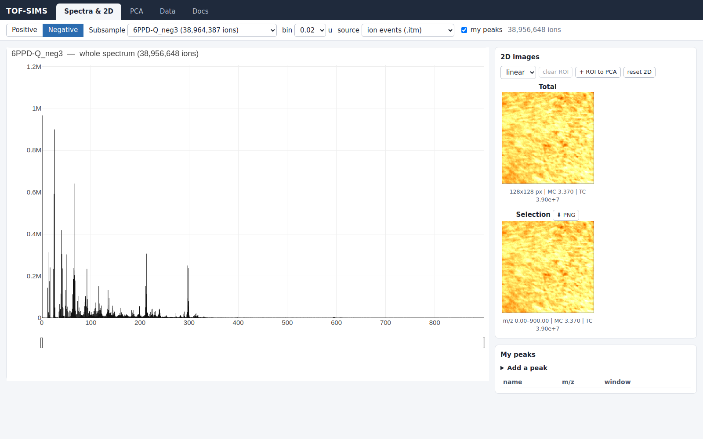
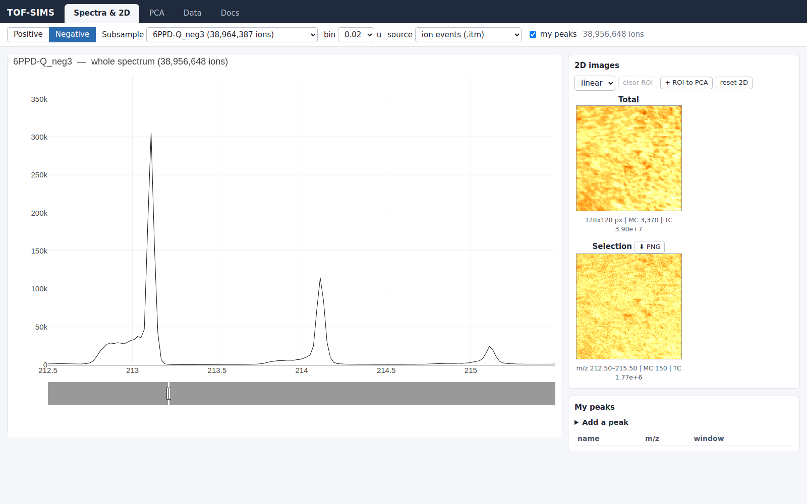
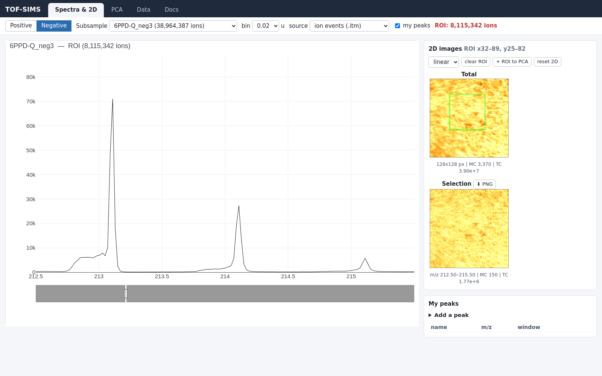
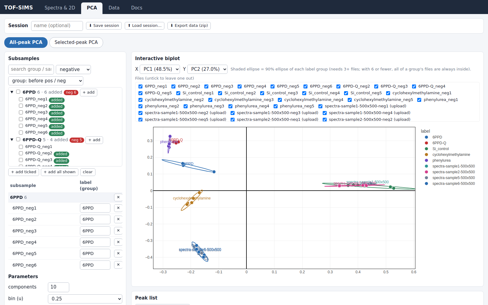
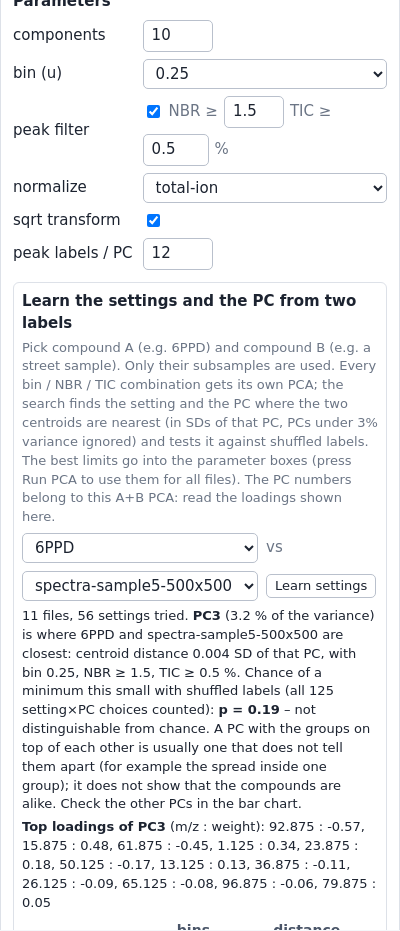
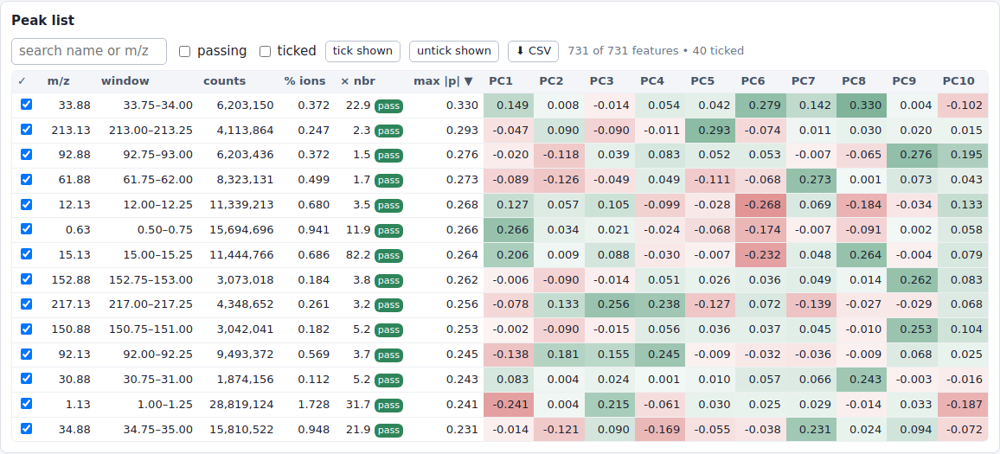
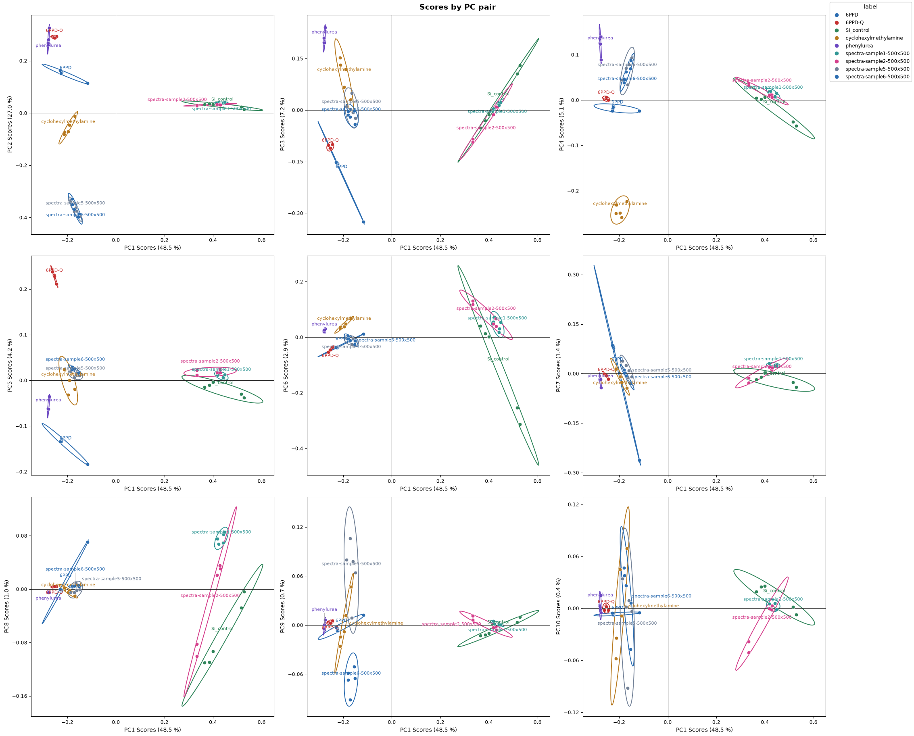
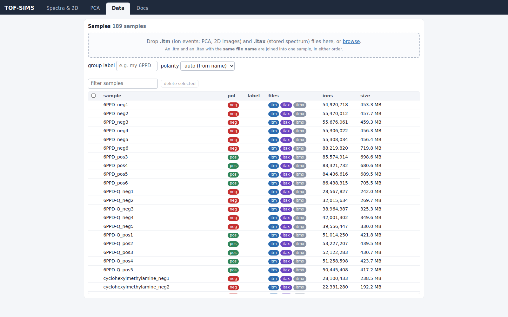
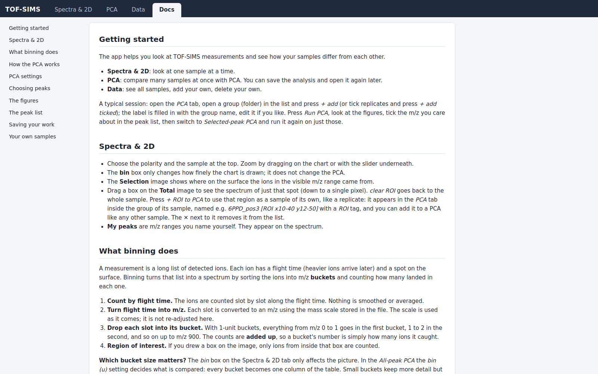

# TOF-SIMS Driver

Read **IONTOF TOF-SIMS** files (`.itm`, `.ita`, `.itax`, `.itmx`), browse their spectra and 2D ion
images in the browser, and compare many samples with PCA. Available as a Python package
(`tof-sims-driver`, import name `tof_sims_driver`) with three commands:

| Command | What it does |
|---|---|
| `tofsims-load <input_dir> <output_dir>` | Convert IONTOF files into `raw_*` data (spectrum, images, ion events, peaks). |
| `tofsims-serve <processed_dir>` | Start the browser app: spectra & 2D, PCA, sample list with uploads, docs. |
| `tofsims-probe <file>` | Dump the internal block tree of an IONTOF file (debugging). |

## Install

Python 3.10 or newer. Tested on Python 3.12 / Linux.

```bash
pip install tof_sims_driver-0.1.0-py3-none-any.whl     # a release file (wheel or .tar.gz)
# or, from a source checkout:
pip install .              # add -e for an editable install, and [dev] for pytest / build / twine
```

All dependencies (numpy, pandas, pyarrow, scipy, scikit-learn, matplotlib, plotly, [pySPM](https://github.com/scholi/pySPM))
are installed automatically. The package is not on PyPI yet, so `pip install tof-sims-driver` will not work until it is published (see *Releasing*).
An NVIDIA GPU is optional: with [cuML](https://docs.rapids.ai/install) installed the PCA runs on the GPU, otherwise it falls
back to scikit-learn, then numpy.

## Quick start

```bash
tofsims-load  /path/to/iontof_files  /path/to/processed          # 1. convert (one folder per file)
tofsims-serve /path/to/processed --port 8765                     # 2. open http://127.0.0.1:8765/
```

`tofsims-serve` keeps the samples you upload in the browser in a separate folder next to the data
(`/path/to/processed_uploads`; change it with `--uploads`, turn uploads off with `--no-upload`).
Add `--host 0.0.0.0` to make it reachable from other machines; anyone who can reach the port can upload.

### Use as a library

```python
from tof_sims_driver.store import Store
from tof_sims_driver.pca import compute_pca

store = Store("/path/to/processed")
names = ["6PPD_pos3", "6PPD-Q_pos1", "Si_control_pos1"]
res = compute_pca(store, names, ["6PPD", "6PPD-Q", "ctrl"],
                  ncomp=2, normalize="tic", sqrt=True, mode="all", bin_width=1.0)
res["scores"]         # one row per sample, one column per PC
res["explained"]      # share of the variance of each PC
res["steps"]          # every preprocessing step with its numbers
res["figures"]        # the PNG figures (data URIs)
res["counts"]         # raw ion counts, one row per sample, one column per feature

from tof_sims_driver.export import results_zip
open("analysis.zip", "wb").write(results_zip([res], name="my run"))   # CSV tables + figures
```

Use `figures=False` to skip drawing, and `mode="mine"` with `peaks=[{"name": ..., "lo": ..., "hi": ...}]` to run on chosen m/z windows.

## Interactive browser (`tof_sims_driver.server`, `sims_server.py`)

A single-page app. The interface holds only controls and results; every explanation is in the **Docs** tab,
written in plain language.

1. **Spectra & 2D** — pick polarity and subsample; raw-count spectrum with a range slider; 2D image for any
   m/z range; draw a box on the total image for a ROI spectrum (down to one pixel) and, with *+ ROI to PCA*,
   use that region as a sample of its own (a replicate of its sample) in the PCA tab; your own named peak
   windows persist in `user_peaks.json`.
2. **PCA** — *All-peak PCA* (every m/z bin is a feature) and *Selected-peak PCA* (only the
   files and m/z ticked in the All-peak PCA). Both give the same figures, in the style of published ToF-SIMS PCA
   plots (scores with outlined 90% ellipses and crosshairs, loadings as stick spectra labelled with their m/z):
   a scree plot (explained variance, plus per label how its separation is shared between the PCs); the scores of
   **every pair of PCs** with all labels coloured and named in every panel; **one row per PC** with the score of every
   file as a dot plot next to that PC's loading spectrum, the labels on its positive / negative side named in the
   corners; driving peaks; and, when files have labels, a label by PC heat map and a dot plot of the top loadings per
   label. Only the All-peak PCA has the **interactive biplot** (files only, with the ellipses) and the
   explorable **peak list** (search, sort, passing / ticked filters, CSV, loadings of every PC); the
   Selected-peak PCA has neither because its files and peaks are already chosen.
   The All-peak PCA has a **peak filter** (on by default): bins below the **NBR** limit (intensity ÷ strongest
   neighbouring bin, default 3) or the **TIC** limit (share of all ions of the chosen files, default 0.5 %) are removed
   before the PCA; files are still normalised by their full total. API: `filter_peaks`, `ratio_min`, `frac_min`.
   The **peak list** shows every feature (3,601 bins at 0.25 u), not a first page.
   **Learn settings** (All-peak PCA, `POST /api/pca/tune`): pick compound A and compound B (two labels of the file list); a
   grid over bin width, NBR and TIC is run on their files only. It returns the setting and the PC on which the two centroids
   are nearest (distance in SDs of that PC, PCs under 3 % variance ignored), a shuffled-label p-value that counts every
   setting × PC tried, the loadings of that PC and a figure (distance per PC, loading spectrum, pair plot). The best limits
   are put into the parameter boxes; press *Run PCA* to use them for all files. The PC numbers belong to the A+B PCA, not to
   the later run on all files.
   **Sessions:** *Save session* (top of the tab) downloads one JSON file with the files and labels, settings,
   ticks, biplot axes, peak-list filters and the results of both tabs, figures included. *Load session…* shows it all
   again without recomputing. Files are validated before anything is shown (damaged, edited or foreign files are
   refused); samples missing on the server are flagged but the results still show. A session holds no raw data and is
   typically a few MB. It also holds the numbers behind every figure, including the raw ion counts.
   **Export data (zip)** downloads, per PCA, plain CSV tables (`counts_raw.csv` raw ion counts per file and m/z bucket,
   `scores.csv`, `loadings.csv`, `explained_variance.csv`, `ellipses_90.csv`, `files.csv`), `settings.json` and the figure
   images, with a README that shows how to redo the PCA from the raw counts. In Python: `tof_sims_driver.export.results_zip`.
3. **Data** — one list of all samples. Drop `.itm` (ion events: PCA, 2D images) and `.itax` (SurfaceLab's stored
   spectrum, shown as an alternative *source* in the Spectra tab) files on the box to add your own (optional group
   label and polarity). An `.itm` and an `.itax` with the same file name become one sample, in either order; an
   `.itax` alone is kept and marked *needs .itm*. They are converted in the background and then appear everywhere,
   marked *(upload)*. Delete your own samples one by one or several at once (all their files go). A region of
   interest added to the PCA is tagged `[ROI x..-.. y..-..]` with an *ROI* badge.
4. **Docs** — getting started, what binning does, how the PCA works, the settings, choosing peaks, the
   figures, the peak list, saving your work, your own samples.

### Where the data lives

| | Reference samples | Your uploads |
|---|---|---|
| Directory | `ROOT` (`make serve`: `$(OUT)`) | `--uploads` (default `ROOT_uploads`; `make serve`: `$(UPLOADS)`) |
| Written by | `make data` only | the browser: `incoming/` (original file), `processed/` (converted data) |
| Sample key | `6PPD_pos3` | `user:<file name>` |
| Deletable in the browser | no | yes |

The two directories are kept apart on disk (the browser never writes into `ROOT`), but the samples are listed
and analysed together. The uploads directory must not lie inside `ROOT`. Uploads are `.itm` (needed for PCA and images)
and `.itax` (stored spectrum); polarity is read
from the file name or set at upload. Anyone who can reach the server can upload, so start it with `--no-upload`
for a read-only server; the size limit is `--max-upload-gb` (default 8).

## Screenshots

Captured at 100% browser zoom (1600×1000) against negative-polarity samples: the `6PPD`, `6PPD-Q`, `Si_control`,
`cyclohexylmethylamine` and `phenylurea` standards and the uploaded `spectra-sample1/2/5/6-500x500` files.

**Spectra & 2D** — raw-count spectrum, total-ion image, and a per-range selection image.



**Zoom → 2D image** — zoom the spectrum (here m/z 212.5–215.5 of `6PPD-Q_neg3`) and the *Selection* image maps that m/z window.



**ROI spectrum** — drag a box on the *Total* image to get the spectrum of just that region (down to one pixel); *+ ROI to PCA* uses it as a sample.



**All-peak PCA** — subsample picker, interactive biplot (files with a 90% ellipse per label) and the parameters, including
the bin width and the NBR / TIC peak filter.



**Learn settings** — pick compound A and B; the best bin / NBR / TIC and the closest PC (with its loadings and the figure)
are shown and put into the parameter boxes.



**Peak list** — every feature of the run (here 731 bins after the filter), sortable and filterable, with the loading of every PC; tick
the m/z for the Selected-peak PCA.



**Scores figure** — scores of every PC pair with a 90% confidence ellipse per label group (first rows of the figure).



**Data** — all samples in one list, with upload and delete.



**Docs** — plain-language help.



### HTTP API

| Endpoint | Description |
|---|---|
| `GET /` | Single-page app (`?pol=pos\|neg` preselects polarity). |
| `GET /api/samples` | Samples with polarity, dimensions, event count, `source` (`reference` \| `user`), label, size. |
| `POST /api/upload?filename=F&label=L&polarity=auto` | Raw file body → conversion job (uploads only). |
| `GET /api/upload/status` | Conversion jobs. |
| `DELETE /api/upload?sample=user:S` | Remove an uploaded sample (reference samples cannot be deleted). |
| `GET /api/truepeaks?sample=S` | Expert peaks for a sample. |
| `GET /api/spectrum?sample=S&...` | Raw-count spectrum; optional ROI box, bin width, mass max. |
| `GET /api/image?sample=S&lo=&hi=` | 2D image for an m/z range (uint32 LE). |
| `GET /api/image?sample=S&all=1` | 2D image of every ion. |
| `GET /api/peaks` | User peaks. |
| `POST /api/peaks` | Create a user peak `{name, lo, hi}`. |
| `DELETE /api/peaks?id=N` | Remove a user peak. |
| `POST /api/export` | `{name, results:[<PCA result>, ...]}` → zip of the CSV tables and figures. |
| `POST /api/pca` | `{samples:[{sample,label}], n_components, normalize, sqrt, mode: all\|mine, bin \| peaks, filter_peaks, ratio_min, frac_min}` → scores, loadings, steps, figures. `filter_peaks` (All-peak only) drops bins below `ratio_min` (NBR) or `frac_min` (TIC share). A `sample` may be a region of interest, `NAME@roi:x0,y0,x1,y1` (pixels, inclusive). |
| `POST /api/pca/tune` | `{samples, refs:[A,B], normalize, sqrt}` → best bin / NBR / TIC, the PC where A and B are closest, its loadings, a shuffled-label `p_corr`, a figure. |
| `GET /api/pca/steps?mode=all\|mine` | Preprocessing (and peak-selection) steps with formulas. |

## Choosing ions for 6PPD and 6PPD-Q (negative polarity)

Findings from the reference data in `/mnt/ceph_drive/processed` (negative files of `6PPD` neg1-neg6, `6PPD-Q` neg2-neg5,
`Si_control`, `cyclohexylmethylamine`, `phenylurea`) and the samples of interest, the `spectra-sampleN-500x500-negK` files uploaded
through the browser (`/mnt/ceph_drive/processed_uploads`, keys `user:spectra-sampleN-500x500-negK`: samples 1, 2, 5 and 6,
neg1-neg5, plus `sample5` pos5; samples 3 and 4 are not uploaded). The `FI-*` files are a different set and are not used here.
`6PPD-Q_neg1` is left out (it is nearly empty at the diagnostic ion). The bin ranges below are for the **0.25 u** All-peak PCA
(bins `lo-hi` are multiples of 0.25, as in `all_peak_pca_peaks.csv`). Re-run the checks when the data changes.

### Settings to use
| Setting | Value | Why |
|---|---|---|
| bin | **0.25 u** | Peaks are 0.03-0.06 u wide (FWHM: Cl- 34.97, C2H3O2- 59.01, 6PPD-Q 297.2). 1 u and 2 u merge neighbouring species and wipe out the difference between the samples (see below); 0.05-0.1 u gives 9,000-18,000 mostly empty bins with no gain. |
| **NBR** | **>= 1** | At 0.25 u one peak covers 1-3 bins. NBR >= 1 keeps the bin that is at least as high as both neighbours (the top of each peak, 962 of 3,601 bins) and drops its shoulders. NBR >= 1.5 keeps 332 bins and loses more peak tops; NBR >= 3 keeps 59 bins and only 2 of the 12 6PPD-Q diagnostic bins. |
| **TIC** | **>= 0.005 %** (0.01 % for a shorter list) | Keeps the faint 6PPD ions at 0.006-0.017 % of all ions; 752 bins with NBR >= 1 (560 at 0.01 %). 0.05 % keeps only 2 of the 10 6PPD diagnostic bins, because TIC keeps big peaks and drops small ones. |

Check on the 20 uploaded files plus the 6PPD, 6PPD-Q and Si standards (same files in every row, bins computed on all of them):

| NBR | TIC | bins kept | standards right (leave-one-out, PC1-5) | samples 5/6 distance to 6PPD / 6PPD-Q / Si | samples 1/2 distance to Si |
|---|---|---|---|---|---|
| 0 | 0 | 3,601 | 100 % | 0.74 / 0.88 / 0.94 | 0.20 |
| 0 | 0.01 % | 1,377 | 100 % | 0.70 / 0.87 / 0.94 | 0.20 |
| **1** | **0.005 %** | **752** | **100 %** | **0.60 / 0.73 / 0.77** | **0.18** |
| 1 | 0.01 % | 560 | 100 % | 0.60 / 0.73 / 0.77 | 0.18 |
| 1.5 | 0.01 % | 289 | 100 % | 0.47 / 0.61 / 0.65 | 0.17 |
| 3 | 0.01 % | 59 | 100 % | 0.28 / 0.38 / 0.53 | 0.19 |

The standards separate 100 % in every row, so they cannot choose the limits; the choice rests on what the filter keeps. The
ranking of the samples (1 and 2 on Si, 5 and 6 nearest 6PPD) does not change with the limits, and the distances shrink as NBR
rises only because fewer bins are left. NBR and TIC are computed on the pooled chosen files, so they change when you add or
remove files: use the same files when comparing runs. The *Learn settings* box cannot choose between them on this data for the same reason.

### Why the default peak list does not work
- The 40 ions ticked by default are the largest loadings of the run. 31 of them are below m/z 100 (H, C, CH, O, OH, C2, CN, Cl,
  hydrocarbon fragments), several at more than 1 % of all ions. They are generic matrix ions: they set the total used for
  total-ion normalisation and damp a trace signal. Untick them.
- The ticked bins at 297.375, 297.625, 297.875, 298.125 and 298.375 are the 297.225 / 298.225 species (see below), not the
  6PPD-Q ion; of the 40, only 214.125 and 298.125 (and the shoulder 298.375) fall in the ranges below.
- In the **Selected-peak PCA** files are divided by the sum of the *selected* peaks only, so the matrix does not set the
  denominator. Tick marker ions only; a strong selected peak still dominates that sum, and with 3-5 peaks the values depend on
  each other (check `counts_raw.csv`). The peak filter and the Learn-settings box exist only in the All-peak tab.

### Ranges to tick (0.25 u bins)
Enrichment = 25th percentile of the standard's replicates (ppm of total ions) divided by the 90th percentile of the Si control,
cyclohexylmethylamine and phenylurea; only ranges at least 2x the blanks and above 60 ppm are listed. *TIC* and *NBR* are the
values of the peak-top bin in `all_peak_pca_peaks.csv`. Tick the bins of a range whose NBR is >= 1 (the peak tops); the shoulders
are removed by the filter anyway.

**6PPD-Q** (best ranges first)

| Range (m/z) | Enrichment | Standard ppm | Si ppm | Peak-top bin | TIC | NBR | Note |
|---|---|---|---|---|---|---|---|
| 298.00-298.50 | x39 | 19,435 | 172 | 298.00-298.25 | 0.148 % | 2.1 | the 298.225 species, not [M-H]- |
| 212.50-213.25 | x25 | 29,646 | 393 | 213.00-213.25 | 0.244 % | 2.3 | |
| 299.00-299.50 | x17 | 7,409 | 233 | 299.00-299.25 | 0.068 % | 1.8 | |
| 223.75-225.25 | x14 | 16,168 | 1,039 | 224.00-224.25, 224.75-225.25 | 0.066 %, 0.08 % | 2.0, 1.0 | |
| 214.00-214.25 | x13.5 | 9,556 | 101 | 214.00-214.25 | 0.113 % | 2.3 | ticked by default |
| 296.00-296.50 | x12 | 3,057 | 177 | 296.00-296.25 | 0.041 % | 2.0 | |
| 290.00-290.25 | x11 | 2,633 | 100 | 290.00-290.25 | 0.040 % | 3.1 | |
| 297.00-297.25 | x11 | 16,949 | 84 | 297.00-297.25 | 0.196 % | 2.7 | holds the real [M-H]- (297.175) **and** the 297.225 species |
| 240.50-241.25 | x9 | 4,694 | 471 | 241.00-241.25 | 0.059 % | 1.5 | |
| 239.50-240.25 | x8 | 6,410 | 981 | 240.00-240.25 | 0.073 % | 2.0 | |
| 185.75-186.50 | x8 | 6,136 | 794 | 185.75-186.25 | 0.056 % | 1.0 | |
| 289.00-289.25 | x8 | 2,043 | 181 | 289.00-289.25 | 0.039 % | 1.9 | |

**6PPD** (no strong ion: the standard shows its [M-H]- only weakly)

| Range (m/z) | Enrichment | Standard ppm | Si ppm | Peak-top bin | TIC | NBR | Note |
|---|---|---|---|---|---|---|---|
| 207.75-208.25 | x6.6 | 2,777 | 338 | 208.00-208.25 | 0.064 % | 2.3 | 6PPD-Q standard has 1,084 ppm here |
| 193.00-193.25 | x5.2 | 3,349 | 176 | 193.00-193.25 | 0.086 % | 1.3 | 6PPD-Q standard has 753 ppm |
| 361.75-362.25 | x5.1 | 645 | 128 | 362.00-362.25 | 0.017 % | 1.7 | |
| 372.00-372.25 | x6.7 | 484 | 58 | 372.00-372.25 | 0.016 % | 1.6 | |
| 386.50-387.25 | x5.3 | 892 | 179 | 387.00-387.25 | 0.017 % | 1.6 | |
| 462.75-463.25, 464.75-465.25, 493.75-494.50 | x5 | 510-610 | 77-116 | | 0.006-0.013 % | 0.6-1.1 | needs TIC >= 0.005 % |
| 548.00-548.50 | x5.9 | 609 | 72 | 548.25-548.50 | 0.012 % | 2.0 | needs TIC >= 0.005 % |
| 629.00-629.50, 630.00-630.50 | x7.5 | 420-500 | 47-49 | 629.25-629.50, 630.25-630.50 | 0.015 %, 0.012 % | 3.0, 2.7 | needs TIC >= 0.005 % |

300.00-300.25 is not listed: it is as strong in the 6PPD-Q standard (1,010 ppm) as in 6PPD (849 ppm). Fragment ranges are chosen
from the data; no formulas are assigned. The high-mass 6PPD ranges are only in the 6PPD standard and are not assigned.

**Exact ions** (use a narrow window, not a 0.25 u bin; add it under *peaks...* or `POST /api/peaks {name, lo, hi}`):

| Ion | Window | Evidence |
|---|---|---|
| 6PPD-Q [M-H]- (297.161) | 297.15-297.20 | 2,900 ppm median in `neg2`-`neg5` at 297.175 (+-0.025 u), range 644-3,859; Si 18 |
| 6PPD [M-H]- (267.187) | 267.15-267.22 | 745-806 ppm in all six standards (+-0.05 u); about 170-320 in 6PPD-Q; Si 11-22. In the CSV it is the unticked bin 267.00-267.25 (TIC 0.050 %, NBR 1.8) |

### The 297-299 bins are not 6PPD-Q
Mass calibration is good (O-, OH-, C2H-, CN-, Cl- are within 0.012 u of their exact masses), yet the strongest peaks of the
6PPD-Q standard sit at m/z 297.225, 298.225 and 299.225. The real [M-H]- shows at 297.175 and is about 4x weaker. A 0.25 u bin
cannot separate them: bin 297.00-297.25 holds both, and the 297.225 peak (0.06 u wide) also spills into 297.25-297.50. The
bins around 298 separate the 6PPD-Q standard film from the other standards, but they mostly measure another species.

### Which bin width (u)
- **All-peak PCA: 0.25 u.** At 0.05-0.5 u samples 1 and 2 land on the Si control and samples 5 and 6 are nearest to 6PPD
  (0.62-0.74 in PC1-5; Si group radius 0.23, 6PPD group radius 0.08). At 1 u and 2 u every unknown is just "Si" and samples
  5/6 are equally far (0.50 / 0.54 / 0.47) from 6PPD, 6PPD-Q and Si, because neighbouring peaks are merged.
- **Selected-peak PCA: windows of about +-0.05 u** (0.10 u wide, up to +-0.1 u for weak noisy peaks) around the exact mass.

### The uploaded samples (`spectra-sampleN-500x500`, negative)
- They have 26-63 million ions, like the standards, so signal is not limited by acquisition time.
- At the exact ions (+-0.025 u) every sample is at the Si-control level: 297.175 is 12-34 ppm (one `sample6` file 155) against
  18 for Si; 267.19 is 7-30 ppm against 11 for Si.
- Samples 1 and 2 sit on the Si control (distance 0.15-0.33 in PC1-5): nothing of 6PPD or 6PPD-Q.
- Samples 5 and 6 are nearest to 6PPD but about 8x the 6PPD group radius and 0.9 from Si: a different matrix that looks more
  like 6PPD than 6PPD-Q or Si, not a match. Possible traces (1 u bins, medians of the five files): 208-209 is 2,000-2,600 ppm
  against 770 for Si and 3,500 for the 6PPD standard (a 6PPD bin); 224-225 (1,300-1,800 against 720) and 298-299 (900-1,000
  against 390) are 2-2.5x Si (6PPD-Q bins). Single-bin evidence: confirm with the exact-mass windows and by region of interest
  before calling it a detection. The pooled medians in the tables above hide this because samples 1 and 2 are at Si level.
- Averaging a whole scan hides a trace compound on particles; add a region of interest (*+ ROI to PCA*) where the ion is enriched.

### Checks before trusting a comparison
- `6PPD-Q_neg1` is nearly empty at the diagnostic ion and `6PPD-Q_neg4` is weak: drop or relabel them. (In positive polarity
  `6PPD-Q_pos1` and `pos2` are empty the same way.)
- The four positive `6PPD_pos3`-`pos6` replicates agree within about 3 %: probably one spot, not four independent measurements.
- A PC with the two groups on top of each other (smallest centroid distance) is usually one that does not tell them apart,
  not proof that they are alike. Judge by the distance with the shuffled-label `p_corr`, not by picking PC pairs by eye (10 PCs
  give 45 pairs, and some pair always looks close).

## Data flow

```
data/  (*.itm, *.ita, *.itax, *.itmx)
  │
  │  make data  →  data_load.py
  ▼
processed/<subsample>/<ext>/
  ├── raw_spectrum.parquet      channel, mass, counts
  ├── raw_summary.json          metadata (sf, k0, image dims, event stats)
  ├── raw_peaks.parquet         expert-annotated peaks (name, SN, lmass/cmass/umass)
  ├── raw_images.npz            2D image per peak + 'total'
  ├── raw_profiles.parquet      intensity vs scan per peak (when available)
  ├── raw_events_ch.npy         ion-event channel keys (for on-demand spectra)
  ├── raw_events_pix.npy        ion-event pixel keys (for on-demand 2D images)
  └── raw_snapshots.npz         camera images (.itax only)
```

### Format support

| Extension | Reader | Notes |
|---|---|---|
| `.itm` | `do_itm_raw` | No stored spectrum — rebuilt from raw ion events. Also builds 2D images and saves ion-event arrays for the interactive server. |
| `.ita` | `do_itm_ita` (pySPM) | Stored spectrum + images + peak list. |
| `.itax` | `do_itax` (pySPM) | Stored spectrum + mass intervals + per-scan profiles + camera snapshots. |
| `.itmx` | `do_itmx` | Peaks + metadata only; the SIMSData blob is not yet decoded. |

## Debugging / format exploration

```bash
# Dump the block tree of a single file
make probe                          # uses PROBE_BASE="6PPD neg1"
make probe PROBE_BASE="my sample"   # different base name

# Print the raw binary structure of .itm / .itmx files
.venv/bin/python probe_itm_itmx.py "data/my_file.itm" > probe_report.txt
```

## Development

### Repository layout

| File / dir | Purpose |
|---|---|
| `pyproject.toml` | Python package metadata (`tof-sims-driver`, import name `tof_sims_driver`). |
| `src/tof_sims_driver/` | **The library.** `data_load` (READ step), `data_probe`, `store` (ion events → spectra / images / peaks), `pca` (preprocessing, peak filter, PCA, steps & formulas), `tune` (bin / NBR / TIC and closest-PC search), `export` (CSV tables + zip), `uploads` (browser uploads), `figures` (matplotlib PCA figures), `server` (interactive browser), `static/app.html` (single-page app). |
| `tests/` | pytest suite (`make test`). |
| `data_load.py` | Shim → `tof_sims_driver.data_load` (**READ step**: parses IONTOF files and writes `raw_*` outputs). |
| `data_probe.py` | Shim → `tof_sims_driver.data_probe` (dumps the internal block tree of an IONTOF file). |
| `probe_itm_itmx.py` | Prints the raw binary structure of `.itm` / `.itmx` files to guide reader development. |
| `sims_server.py` | Shim → `tof_sims_driver.server` (**interactive browser**, 4 tabs: *Spectra & 2D*, *PCA*, *Data*, *Docs*). |
| `check_manualannotatedspectra.py` | Backward-compat shim — just launches `sims_server.py`. |
| `check_pipelinepeakidentification.py` | (Mostly commented out) earlier peak-identification experiment. |
| `Makefile` | Orchestration: venv setup, data loading, processing, probing, serving. |
| `pySPM/` | Nested clone of [scholi/pySPM](https://github.com/scholi/pySPM) (has its own repo; git-ignored here). |
| `data/` | Raw instrument files (git-ignored). |
| `processed/` | Pipeline output (git-ignored, regenerable). The Makefile default `OUT` is now `/mnt/ceph_drive/processed`. |

#### Data storage (symlinked)

The raw data lives on the Ceph drive and is linked into `data/` with `ln -s`, not copied:

```bash
ln -s "/mnt/ceph_drive/For Jose" "/home/cloud/tof_sims_driver/data/For Jose"
ln -s "/mnt/ceph_drive/Proj. Tire Additives" "/home/cloud/tof_sims_driver/data/Proj. Tire Additives"
```

Check the links with `ls -l data/`. If `/mnt/ceph_drive` is not mounted the links dangle and `make data` finds no files.

### Working in this checkout (Makefile)

The installed package needs no Java. Java 17 is only used by the older `make proc` step (PySpark):

```bash
sudo apt update && sudo apt install -y openjdk-17-jdk
```

```bash
# 1. Create the venv: installs the package (editable, with [dev]) plus the extras the Makefile uses
make venv

# 2. Load raw IONTOF files from ./data into ./processed
make data

# 3. (Optional) Run the processing / calculation step
make proc RATE=0.5        # sputter rate in nm/scan

# 4. Launch the interactive browser
make serve                 # http://0.0.0.0:8765/  (LAN-reachable)
# or restrict to localhost:
make serve HOST=127.0.0.1
```

`make all` runs `data` + `plots` + `proc` in sequence.

### Tests and building

```bash
make test        # pytest suite (runs on small synthetic data, no instrument files needed)
make dist        # builds dist/tof_sims_driver-<version>-py3-none-any.whl and .tar.gz
```

The top-level `sims_server.py`, `data_load.py` and `data_probe.py` are thin shims, so the old commands
(`python sims_server.py ...`) keep working from a checkout.

### Optional: GPU acceleration for PCA

```bash
make gpu                   # installs cuml-cu12 (needs NVIDIA GPU + ~2 GB disk)
```

### Make targets

| Target | Description |
|---|---|
| `venv` | Create `.venv` and install all Python dependencies. |
| `java` | Verify Java is installed and print `JAVA_HOME`. |
| `data` | Run `data_load.py` over `./data` → `./processed`. |
| `proc` | Run `proc_calc.py` on `./processed` (requires `RATE`). |
| `probe` | Dump block trees for `.itax` / `.itm` / `.itmx` files (default base: `6PPD neg1`). |
| `inspect` | List all `raw_*` / `calc_*` files under `./processed`. |
| `serve` | Start the interactive browser (default `0.0.0.0:8765`). |
| `plots` | Alias for `serve` (kept for backward compatibility). |
| `gpu` | Install cuML for GPU-accelerated PCA. |
| `clean` | Remove `./processed` entirely. |
| `clean-calc` | Remove only `calc_*` files (keeps `raw_*`). |

## Notes

- `pySPM/` is a nested git repository (scholi/pySPM) and is excluded from this repo via
  `.gitignore`. It is installed in editable mode (`pip install -e pySPM/`) into the venv.
- Raw instrument data (`data/`) and pipeline output (`processed/`) are git-ignored.
- The `bk.*` files are backups of earlier versions of the active scripts.

## Releasing

```bash
# 1. bump `version` in pyproject.toml and commit
make dist                                   # builds dist/*.whl and dist/*.tar.gz
.venv/bin/twine check dist/*                # validates the metadata
# 2. try it in a clean environment first
python -m venv /tmp/try && /tmp/try/bin/pip install dist/*.whl && /tmp/try/bin/tofsims-serve --help
# 3. publish (needs an API token from pypi.org; use --repository testpypi to rehearse on test.pypi.org)
.venv/bin/twine upload dist/*
```

Releases are tagged `vX.Y.Z`. Only the package under `src/tof_sims_driver/` is distributed; the checkout's
`Makefile`, shims and screenshots are not.

## License

Apache License 2.0, see [LICENSE](LICENSE). Copyright 2026 Jose Tupayachi.
TOF-SIMS file reading builds on [pySPM](https://github.com/scholi/pySPM) (Apache-2.0, Olivier Scholder).
